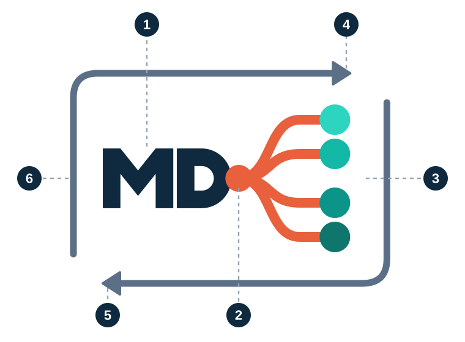
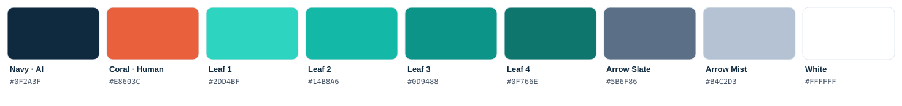
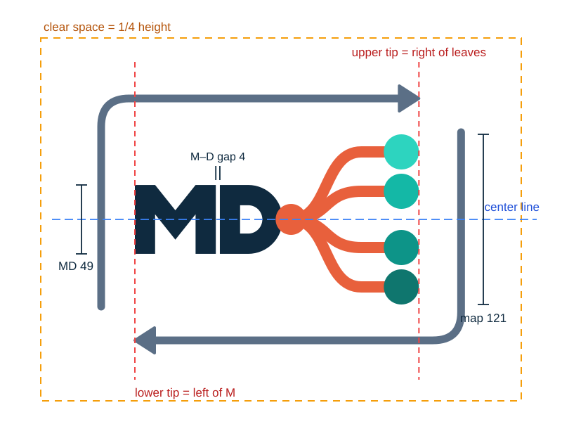

# Mindmap Markdown — Logo and brand

  <picture>
    <source media="(prefers-color-scheme: dark)" srcset="mindmapmarkdown-framed-on-dark.svg">
    
  </picture>

> A cool document and a warm structure join into one, and at its edge, thinking expands.

[한국어 요약](#한국어-요약)

## The story of the mark

1. **MD** — the document AI reads. Emotionless, cool navy. Named after the `.md` extension itself.
2. **Root and branches** — the structure people read. Coral, the color of warmth. The root grows from the curve of the D: document and map are one body.
3. **Four leaves** — thinking expanding. Light to deep green, ideas reaching further and deeper along each branch.
4. **Upper arrow** — the document unfolds into a map (*lift*). It ends at the right edge of the leaves.
5. **Lower arrow** — the map returns to the document (*canonical projection*). It ends at the first stroke of the M.
6. **The loop** — two arrows close one loop. Round-trip stable: nothing is lost in either direction.

## Color palette

| Name | HEX | RGB | Used for |
|---|---|---|---|
| Navy · AI | `#0F2A3F` | 15, 42, 63 | MD letters, body text |
| Coral · Human | `#E8603C` | 232, 96, 60 | Root and branches |
| Leaf 1 | `#2DD4BF` | 45, 212, 191 | First leaf (lightest) |
| Leaf 2 | `#14B8A6` | 20, 184, 166 | Second leaf |
| Leaf 3 | `#0D9488` | 13, 148, 136 | Third leaf |
| Leaf 4 | `#0F766E` | 15, 118, 110 | Fourth leaf (deepest) |
| Arrow Slate | `#5B6F86` | 91, 111, 134 | Frame arrows on light backgrounds |
| Arrow Mist | `#B4C2D3` | 180, 194, 211 | Frame arrows on dark backgrounds |
| White | `#FFFFFF` | 255, 255, 255 | MD on dark backgrounds |

## Construction and alignment

The mark is drawn on a 128-unit grid. These rules hold at every size.

- The gap between M and D is 4 (one fifth of the 20-unit stroke).
- MD height 49 : map height 121. MD stays smaller; the map leads.
- The center of MD, the root, and the center of the leaves sit on one line.
- The root overlaps the rightmost point of the D curve.
- Branches are 8 wide: a moderate curve, then horizontal into each leaf.
- Leaves have radius 12.5, symmetric about the center line.
- Upper arrow tip = right edge of the leaves. Lower arrow tip = left edge of the M.
- Frame stroke 5.5, filled triangular arrowheads.
- Clear space around the mark: at least one quarter of its height.

## Versions

| Version | Light background | Dark background | Use |
|---|---|---|---|
| Framed | [`mindmapmarkdown-framed.svg`](mindmapmarkdown-framed.svg) | [`mindmapmarkdown-framed-on-dark.svg`](mindmapmarkdown-framed-on-dark.svg) | Large placements: avatars, share images, slide covers. 48 px tall or more |
| Plain | [`mindmapmarkdown-mark.svg`](mindmapmarkdown-mark.svg) | [`mindmapmarkdown-mark-on-dark.svg`](mindmapmarkdown-mark-on-dark.svg) | Site header, inside documents, small spaces. 20 px tall or more |
| Mono | [`mindmapmarkdown-mark-mono-navy.svg`](mindmapmarkdown-mark-mono-navy.svg) | [`mindmapmarkdown-mark-mono-white.svg`](mindmapmarkdown-mark-mono-white.svg) | Single-color printing and engraving |
| Favicon | [`favicon.svg`](favicon.svg) | — | Browser tabs and app icons. A dedicated map-only icon |
| Avatar | [`avatar-framed-navy-512.png`](avatar-framed-navy-512.png) | — | Square profile pictures |

## Don't

- Recolor any part of the mark.
- Stretch or squash it.
- Rotate it.
- Add shadows, outlines, or other effects.

## Use of the mark

You may use the mark to refer to the Mindmap Markdown project. Do not use it in a way that suggests endorsement by the project or official status of an implementation.

The M glyph derives from the [Markdown Mark](https://github.com/dcurtis/markdown-mark) by Dustin Curtis, dedicated to the public domain (CC0). The D glyph is drawn to match it.

---

## 한국어 요약

> 차가운 문서와 따뜻한 구조가 하나로 이어지고, 그 끝에서 생각이 확장됩니다.

**로고 이야기** (위 그림의 번호)

1. **MD** — AI가 읽는 문서. 감정 없는 차가운 네이비. 마크다운 파일 확장자 `.md` 그대로입니다.
2. **루트와 가지** — 사람이 읽는 구조. 체온을 가진 코랄. 루트는 D의 곡선 끝에서 시작해, 문서와 맵이 한 몸임을 보여 줍니다.
3. **잎 4개** — 생각의 확장. 연한 녹색에서 진한 녹색으로, 가지를 따라 생각이 뻗어 나가며 깊어집니다.
4. **위쪽 화살표** — 문서가 맵으로 펼쳐집니다 (lift). 끝은 잎의 오른쪽 끝에 닿습니다.
5. **아래쪽 화살표** — 맵이 문서로 돌아옵니다 (canonical projection). 끝은 M의 첫 획에 닿습니다.
6. **순환** — 두 화살표가 하나의 고리를 이룹니다. 어느 방향으로 바꿔도 잃는 것이 없는 왕복 안정(round-trip stable).

**색상**: 네이비 `#0F2A3F`(AI) · 코랄 `#E8603C`(사람) · 잎 `#2DD4BF` `#14B8A6` `#0D9488` `#0F766E`(생각의 확장) · 화살표 `#5B6F86` / 어두운 배경 `#B4C2D3`

**정렬 규칙**: M–D 간격 4 · MD 49 : 맵 121 · MD 중앙, 루트, 잎 무리 중앙은 한 중심선 위 · 위쪽 화살표 끝 = 잎 오른쪽 끝선, 아래쪽 화살표 끝 = M 왼쪽 끝선 · 여백은 높이의 1/4 이상

**하지 말 것**: 색 바꾸기 · 비율 변형 · 회전 · 그림자나 효과 넣기
